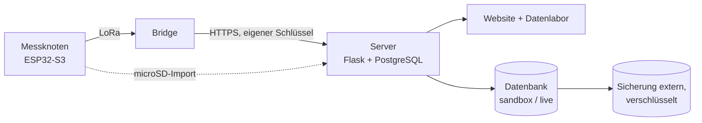
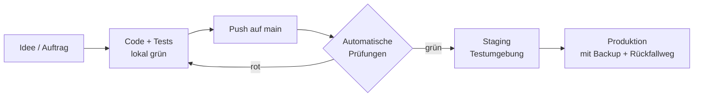

# OpenMycoNet

Ein Citizen-Science-Projekt im Aufbau: ein weltweit vernetzbares System zur Erfassung
bioelektrischer Signale aus Mykorrhiza- und Pilznetzwerken. Die Aktivität ist messbar — die
Frage ist, was ihre Muster bedeuten.

Website: <https://www.openmyconet.de> · Kontakt und Rechtliches: [Impressum](https://www.openmyconet.de/impressum.html)

Dieses Repository enthält die Software. Diese Seite erklärt für Menschen, wie sie aufgebaut ist
und wie an ihr gearbeitet wird; technische Details stehen in den verlinkten Dateien.

## Was wo liegt

| Teil | Ordner | Was es tut |
|---|---|---|
| **Server** | [`openmyconet_server/`](openmyconet_server/) | Website (fünfsprachig), Anmeldung und Dashboard, Förderer, Chatbot, Datenlabor mit simulierten Daten, Empfang und Prüfung der Messdaten, Verwaltung |
| **Firmware** | [`firmware/`](firmware/README.md) | Software für die Messknoten. Bisher fertig: das Erzeugen, Absichern und Signieren der Datenpakete |
| **Automatische Prüfungen** | [`.github/workflows/`](.github/workflows/) | Tests bei jeder Änderung, Erreichbarkeit der Website alle 15 Minuten |

Nicht hier: die Projektsteuerung (Pläne, Status, Partner, Gebrauchsmuster) liegt bewusst in
einem lokalen, nicht öffentlichen Kontrollzentrum mit eigener verschlüsselter Sicherung.

## Wie eine Änderung entsteht

1. **Lokal:** Code und Tests entstehen zusammen; alle Tests müssen vor dem Hochladen grün sein.
2. **Automatische Prüfungen bei jedem Push** (GitHub Actions):
   - die komplette Testsuite, einmal mit SQLite und einmal mit PostgreSQL wie im Betrieb,
   - Code-Stil, Sicherheits-Scan des Codes, bekannte Lücken in verwendeten Paketen,
   - Barrierefreiheit, Suchmaschinen-Tauglichkeit und Qualität aller öffentlichen Seiten,
   - Firmware: Normtests der Kryptografie, die Paket-Testvektoren Byte für Byte, und ein
     Kreuztest, bei dem der Server Pakete aus der Firmware liest und nachrechnet.
3. **Staging:** eine vollständige Testumgebung auf demselben Server, eigene Datenbank, verschickt
   nie echte Mails.
4. **Produktion:** nur möglich, wenn die Prüfungen für genau diesen Stand grün sind und Staging
   ihn hat. Vor jedem Datenbank-Umbau wird gesichert; antwortet die Seite danach nicht, wird der
   alte Code automatisch zurückgespielt.

## Sicherheit, in Schichten

- **Website:** Schutz gegen untergeschobene Formulare (CSRF) und eingeschleusten Code (strenge
  Content-Security-Policy), Zwei-Faktor-Anmeldung für die Verwaltung, Begrenzung von
  Wiederholungsversuchen, geprüfte Uploads.
- **Messdaten:** Jedes Paket trägt Prüfsummen, die eine Kette bilden (Lücken und Änderungen
  fallen auf), und eine Signatur des Messknotens (Ed25519); der Server kennt nur öffentliche
  Schlüssel. Datenbank-Rollen sind getrennt: Die Website kann Messdaten weder löschen noch
  genaue Standorte lesen. Strittige Daten werden nie stillschweigend verworfen, sondern
  aufbewahrt.
- **Betrieb:** Zugang zum Server nur mit Schlüssel, Firewall, tägliche verschlüsselte
  Sicherungen außer Haus mit automatischer Wiederherstellungsprobe, Überwachung von außen.
- **Datenschutz:** feste Löschfristen werden automatisch durchgesetzt und stehen so in der
  Datenschutzerklärung.

## Anpassungsfähigkeit

- **Datenbank-Änderungen** laufen als nachvollziehbare Migrationen; ein Test stellt sicher, dass
  Code und Datenbank nie auseinanderlaufen.
- **Versionierte Formate:** Datenpakete und Datenbank-Schemas tragen Versionsnummern; neue
  Versionen kommen hinzu, ohne alte Daten unlesbar zu machen.
- **Simulation und echte Messungen** laufen durch dieselbe Verarbeitung, aber in getrennten
  Bereichen (`sandbox` / `live`).
- **Die Firmware-Kernbibliothek** ist plattformunabhängig und wird auf dem PC gegen den Server
  geprüft — lange bevor eine Platine da ist.

## Für Entwickler

- Server: [`openmyconet_server/CLAUDE.md`](openmyconet_server/CLAUDE.md) (Aufbau, Regeln,
  Tests, Deploy) und die Themen-Dateien in [`openmyconet_server/docs/claude/`](openmyconet_server/docs/claude/)
- Datenpaket-Format: [`openmyconet_server/docs/dateneingang_format_v1.md`](openmyconet_server/docs/dateneingang_format_v1.md)
- Empfangsweg für Bridges: [`openmyconet_server/docs/dateneingang_empfang.md`](openmyconet_server/docs/dateneingang_empfang.md)
- Firmware: [`firmware/README.md`](firmware/README.md)
